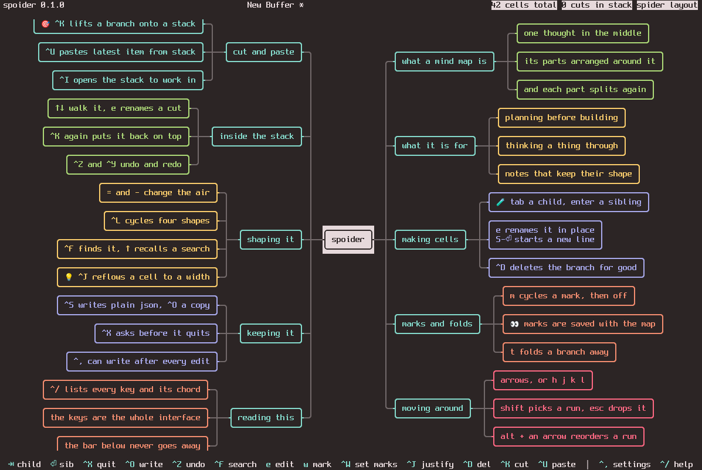
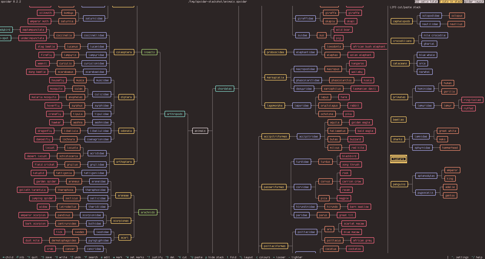

# spoider

A mind map editor for the terminal.

It is a Python TUI built on [Textual](https://textual.textualize.io/), and it is vibecoded.
We are aiming for a perfectly functioning, minimalistic editor. The best of its kind.

Distinct features of spoider, as compared to other mind mapping editors:

- keyboard-oriented navigation
- a LIFO stack of parts cut out of the map, saved with the map
- all aspects of the mind map are saved, so the map renders identically everywhere
- the colour scheme is inherited from the terminal
- five mind map layouts
- the positioning of cells is automatic
- you can choose the spacing between cells



https://github.com/user-attachments/assets/a7252521-8837-4ac1-9f52-0b44ba86c570

A two-minute tour of spoider.

## Install

spoider needs [uv](https://docs.astral.sh/uv/), which also brings a matching Python. Install
it from your package manager where it is packaged:

```bash
sudo pacman -S uv     # for Arch
sudo dnf install uv   # for Fedora 43 and later
sudo apt install uv   # for Debian and Ubuntu
```

On releases without it, use the standalone installer:

```bash
curl -LsSf https://astral.sh/uv/install.sh | sh
```

Then install spoider itself:

```bash
uv tool install git+https://github.com/Ramashvili/spoider
```

That puts `spoider` on your PATH. On first launch, spoider asks whether your desktop should
always recognise `.spoider` files and open them in spoider when you open one from your file
browser; `spoider --install-desktop` does the same thing by hand, without the question.

## Try it without installing

```bash
uvx --from git+https://github.com/Ramashvili/spoider spoider --demo
```

`--demo` opens the built-in manual as a mind map you can explore and edit.

## Run

```bash
spoider                        # start a new buffer
spoider ideas.spoider          # open a map, or create one at that path
spoider --demo                 # open the interactive manual
spoider -p 7.4.3 map.spoider   # land the cursor on the 3rd child of the 4th child of the 7th
spoider -p s2.1 map.spoider    # land on the 1st child of the 2nd cut; opens the stack
spoider --id 9f2c1a8b map.spoider   # land on the cell with that id
```

`--id` refuses a cell the map does not hold, and exits with code 2, so a program that
launches a map can tell. A cut's id opens the stack panel.

## Keys

Key bindings can be set in `~/.config/spoider/spoider.conf`.
Vim-like binds are already waiting there; you only need to uncomment them. That block is a
whole keymap rather than a patch: it names every action, so uncommenting it switches all of
them at once and leaves nothing half-changed.

A chord is either the character you press (`,` `.` `?` `=` `-`), or a key by name
(`tab`, `enter`, `escape`, `space`, `home`, `end`, `pgup`, `pgdn`, `delete`, `f1` and the
rest), and either of those can take `ctrl+`, `alt+` or `shift+` in front of it. Nothing else
is read, and a line the program cannot read is left out rather than guessed at.

### Table of defaults

| Key | Does |
| --- | --- |
| `Tab` / `Return` | add a child, add a sibling |
| `e` | edit the cell's text |
| `↑↓←→` `hjkl` | walk the tree |
| `Alt+↑` / `Alt+↓` | reorder siblings |
| `^K` / `^U` | cut a branch to the stack, paste it under the current cell |
| `p` | open the cut stack panel to inspect or edit cut branches |
| `^D` | delete a branch |
| `w` / `^W` | cycle a cell's mark, or choose which marks this map uses |
| `t` | fold or unfold children |
| `,` | the file's properties, drawn over the map |
| `Home` | the main cell of this tree |
| `End` | the deepest cell below this one |
| `PgUp` | the first sibling under the same parent |
| `PgDn` | the last sibling under the same parent |
| `Del` | delete the cell, as `^D` does |
| `^J` | wrap a cell's text to a chosen column width |
| `^F` | search cells |
| `Alt+F` / `Alt+B` | the next or previous cell the last search found |
| `^L` / `c` | cycle the layout shape, switch colour mode |
| `=` / `-` | loosen or tighten the spacing |
| `^Z` `^Y` | undo, redo |
| `^S` `^O` `^X` | save, save as, quit |
| `.` `?` | your settings in your editor, the full key list |

## How it works

### Writing in cells

A cell grows to fit as many lines as you type. `Shift+Return` adds a new line,
`Shift` with the arrow keys selects text, and `^J` wraps long notes into clean
paragraphs at whatever width you prefer.

### Five ways to draw the tree

Press `^L` to cycle through five shapes for the same map. The arrow keys adapt
automatically to match the drawing on screen:

- **spider:** root in the centre, branches fanning out left and right.
- **branch right:** root on the left, unfolding to the right like an outline.
- **branch left:** the same outline from the other side, root on the right.
- **pyramid:** root at the top, children stacked below.
- **bush:** root at the bottom, growing upwards.

Press `c` to colour either by family (one colour per main branch) or by depth
(one colour per level).

### Moving branches with the stack

Cutting with `^K` places a branch onto a stack, and `^U` pastes the most recent
cut under whichever cell you select next. If you are reorganising a large map,
press `p` to open the stack side-by-side: you can browse what you cut, edit or
fold items inside it, or reorder them before pasting them back.



On the right you can see the LIFO stack, holding branches cut from the map.

### Maps that look the same everywhere

Your layout shape, spacing, colour mode, custom marks, and even unpasted branches
on the stack are saved inside the `.spoider` file itself, along with the cell you
were last on. Opening the same file on another machine gives you the exact same view,
with the cursor where you left it.

Editor preferences like autosave, the tab width and custom keybindings live in
`~/.config/spoider/spoider.conf`. `.` opens that file in your editor and reloads it when you
come back, so changing a setting is changing a line.
A complete example sits in [`examples/spoider.conf`](examples/spoider.conf): it is the very
text a fresh install writes, so you can see what a newer release added without touching the
file you already have.

## Development

```bash
git clone https://github.com/Ramashvili/spoider && cd spoider
uv sync && uv run spoider
uv run pytest
```

See [AGENTS.md](AGENTS.md) for the codebase layout and design notes.

## Inspired by

- [h-m-m](https://github.com/nadrad/h-m-m): a keyboard-first mind map that lives in the terminal.
- [Minder](https://github.com/phase1geo/Minder): a small, quiet mind-mapping app for the desktop.

## Licence

MIT, see [LICENSE](LICENSE).
